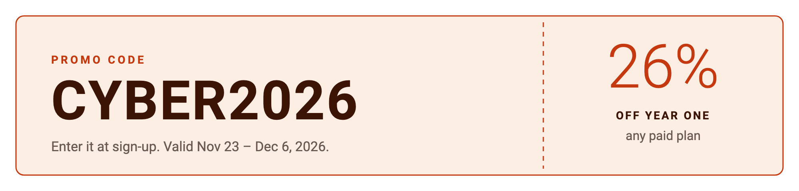
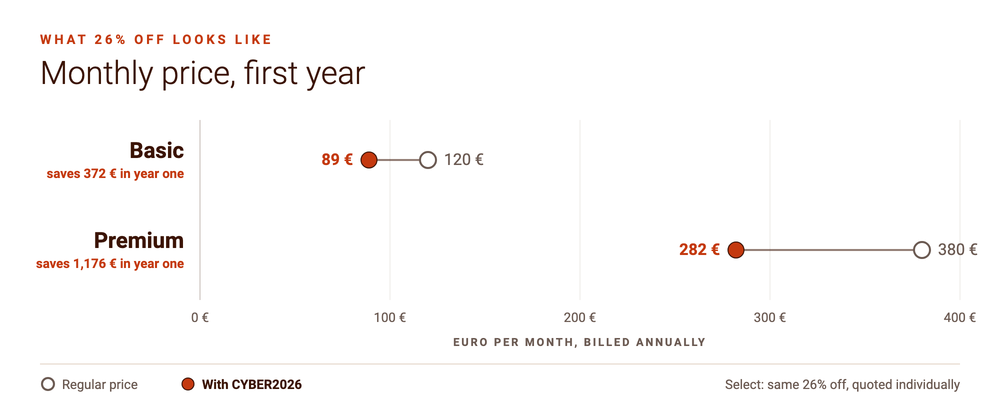
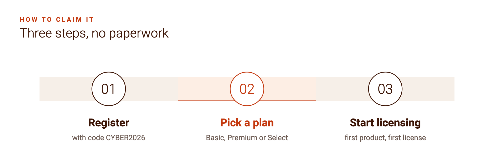

Every software vendor knows the moment: a customer can't activate on a Friday evening, a trial never expires, or a pricing change turns out to be a rewrite. Licensing rarely feels urgent until it hurts, and then it hurts at the worst possible time.

This year, we are giving you a good reason to fix it before that happens. **From November 23 to December 6, 2026, every paid NetLicensing plan is 26% off for your first year.** Basic, Premium or Select, same discount, one code.

## The numbers

Basic drops from 120 € to **89 €** a month, and Premium from 380 € to **282 €**. Over the first year that is **372 €** and **1,176 €** back in your pocket. Running on Select? You get the same 26% on your first-year price. [Tell us what you need]({{ site.url }}/contact/) and we'll send a quote with the discount already in it.

## What you actually get for it

Licensing that works while you sleep. Pick a licensing model (subscription, trial, feature-based, floating, pay-per-use), call a REST API from the language you already write, and see every customer and license in one console. No custom back office, no weekend lost to a key generator. Many teams are live within a day.

Still not sure? The free Community plan stays available, and the discount makes the upgrade easy the day you need it.

## Claim it in three steps

  <a href="https://ui.netlicensing.io/#/register?promoCode=CYBER2026&utm_source=netlicensing.io_blog&utm_medium=website&utm_campaign=cyberweeks-2026" target="_blank" rel="noopener" style="background:#E14817;color:#fff;padding:16px 40px;border-radius:6px;font-size:20px;font-weight:700;text-decoration:none;display:inline-block">Claim 26% off with CYBER2026</a>
  
Ends December 6, 2026

## Fine print, kept short

The offer is for new customers and covers the first year, then the regular price applies. It can't be applied to upgrades of existing accounts. If you prefer an invoice to the online checkout, [write to us]({{ site.url }}/contact/) and mention the code.
December 6 comes faster than you think. Your January self will be glad you did it now.

*Happy Licensing!*
