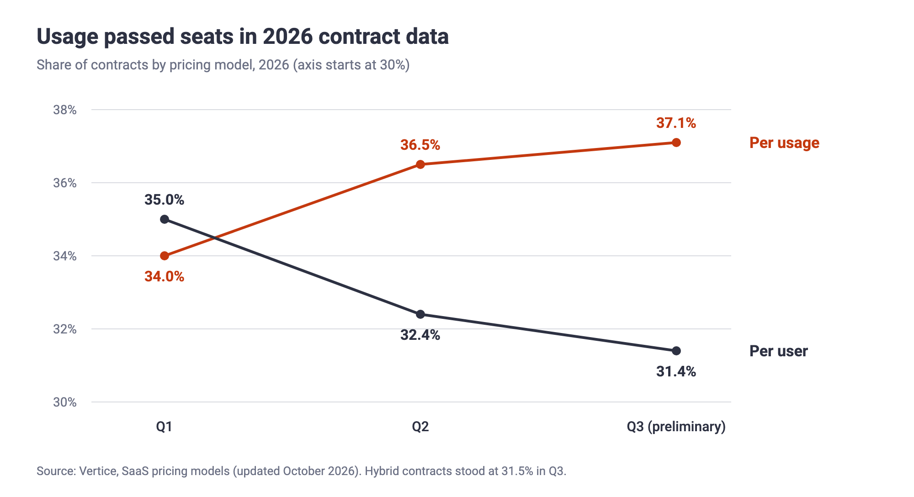

At the start of a renewal call, a vendor and a customer used to argue about one number: how many seats. In 2026 the questions multiplied. How many seats, and how much usage? Does an AI agent count as a user? What happens when the credits run out in the middle of a quarter? Can the software still check its license on a machine with no network?

This report looks back at how software licensing changed in 2026 and what vendors should do about it in 2027.

## Key takeaways

- **Hybrid pricing moved to the front.** In a survey of more than 230 B2B software and AI companies, 37% reported a hybrid model, compared with 25% a year earlier.
- **Usage passed seats in one large set of contract data.** Per-usage pricing reached 37.1% of contracts in the third quarter, while per-user pricing fell to 31.4% (preliminary figures).
- **AI agents broke the old licensing unit.** One agent can do the work of many seats or of none, and many agreements do not say how to count it.
- **Compliance dates arrived.** EU reporting duties for software vulnerabilities and AI transparency rules both started to apply this year.
- **Offline and on-premises did not go away.** Entitlements still have to work where the software runs.
- **For 2027:** meter before you reprice, keep a predictable base, and decide in writing how you count agents.

## About this report

We combined two kinds of material: surveys, contract data, analyst forecasts, legal commentary and official EU pages published up to December 2026, and the public NetLicensing documentation and changelog. The market figures come from third parties and are linked under [Sources](#sources-and-limits). This report contains no statistics drawn from NetLicensing customer or platform data.

## 2026 in numbers

| Indicator | Figure | Source and basis |
| --- | --- | --- |
| Companies with a hybrid pricing model | 37% (25% a year earlier) | Growth Unhinged survey, 230+ companies, April to May |
| Companies that changed pricing or packaging in the last year | About three in four | Same survey |
| Companies using AI credits | 29%, with 33% planning to within 6 to 12 months | Same survey |
| Contracts priced per usage | 34.0% in Q1, 37.1% in Q3 | Vertice contract data, Q3 preliminary |
| Contracts priced per user | 35.0% in Q1, 31.4% in Q3 | Same data |
| SaaS CEOs planning to retire seat-based pricing within two years | 97% of 300 | April survey reported by Userpilot |
| Worldwide AI spending | $2.7 trillion forecast, up 49.5% | Gartner forecast reported by Computerworld |

## Pricing: hybrid became the working answer

The headline of the year is not "subscriptions are over". It is that more vendors now charge for two things at once: a recurring base for access, and a metered or capped part that grows with use.

The vendor survey shows the speed. Hybrid models went from a quarter of respondents to well over a third in twelve months, and AI credits became a common way to meter the new part ([Growth Unhinged](https://www.growthunhinged.com/p/the-state-of-b2b-monetization-in-2026){:target="_blank"}{:rel="noopener nofollow"}). The same research puts the median *target* margin on AI features at about 50%, a reminder of why metering is attractive: when every request has a real cost, a flat fee carries real risk.

Contract data from the buying side points the same way. Per-usage pricing overtook per-user pricing during the year, and hybrid contracts stood at 31.5% in the third quarter ([Vertice](https://www.vertice.one/insights/saas-pricing-models){:target="_blank"}{:rel="noopener nofollow"}).

Read the two sources side by side, not added together. One asks vendors what they sell; the other measures what a set of buyers pays for.

### Seats are being layered, not erased

In an April survey of 300 SaaS CEOs, 97% said they plan to retire seat-based pricing within two years. In the same survey, 94% said it still matches their product's value ([reported by Userpilot](https://userpilot.com/blog/saas-pricing-models/){:target="_blank"}{:rel="noopener nofollow"}). Both can be true: the seat remains a good measure of *access*, and a poor measure of *work done*.

| Model | What the customer pays for | Predictability for the buyer | Fits when |
| --- | --- | --- | --- |
| Per seat | People or accounts with access | High | Value grows with the number of users |
| Subscription | Access for a period | High | Value is steady over time |
| Usage-based | Calls, tokens, volume or time consumed | Low without limits | Cost and value follow activity |
| Hybrid | A base fee plus a metered or capped part | Medium to high | Access and activity both matter |
| Outcome-based | A defined result | Depends on the definition | The result can be measured and agreed |

Outcome-based pricing drew much of the attention, but it is the hardest to run. Deloitte expects hybrid models to become standard and considers widespread outcome-based pricing still a long way off, because vendors and buyers first have to agree on what counts as a task or a result. The same article quotes a Gartner prediction that by 2030 at least 40% of enterprise SaaS spend will shift toward usage-, agent- or outcome-based pricing ([Deloitte, November 2025](https://www.deloitte.com/us/en/insights/industry/technology/technology-media-and-telecom-predictions/2026/saas-ai-agents.html){:target="_blank"}{:rel="noopener nofollow"}). Treat that as a forecast, not a result.

> A price you cannot measure is a price you cannot defend at renewal.

## AI agents: the licensing unit no longer holds

Seat licenses assume that one human generates a predictable amount of activity. Agents break that assumption. A [legal analysis from August](https://www.proskauer.com/blog/does-your-ai-agent-need-its-own-software-license){:target="_blank"}{:rel="noopener nofollow"} by the law firm Proskauer lists the questions contracts now have to answer:

- Does a "user" have to be a person?
- Does each agent need its own license or entitlement?
- May one licensed user run any number of agents?
- Is unattended access treated differently from interactive use?
- Do temporary or parallel agent instances consume extra entitlements?

Money is moving in the same direction. Gartner forecasts worldwide AI spending of $2.7 trillion in 2026, with AI agents and assistants growing 77.3% ([Computerworld](https://www.computerworld.com/article/4225808/ai-spend-will-jump-49-5-in-2026-says-gartner-2.html){:target="_blank"}{:rel="noopener nofollow"}).

No single counting method has won. The practical choice is to keep several available and pick one per product:

| How to count an agent | What is limited | NetLicensing building block | Plans |
| --- | --- | --- | --- |
| As a named identity | Each agent holds a place, bound by an identifier you supply | [Node-Locked](https://netlicensing.io/wiki/node-locked) | Premium and Select |
| By concurrency | Agents running at the same time | [Floating](https://netlicensing.io/wiki/floating) sessions with check-out and check-in | Premium and Select |
| By work consumed | Calls, tokens or other units | [Pay-per-Use](https://netlicensing.io/wiki/pay-per-use) | Premium and Select |
| By capacity | A licensed maximum your application enforces | [Quota](https://netlicensing.io/wiki/quota) | Basic, Premium and Select |
| By capability | Which features an agent may use | [Multi-Feature](https://netlicensing.io/wiki/multi-feature) | Basic and above |

Two details matter in practice. NetLicensing does not generate session IDs or machine identifiers, so your application creates a stable one for each agent. And authentication stays with your identity provider: NetLicensing answers what a customer is entitled to, not who is signing in.

### Agents also started managing licenses

This year we opened NetLicensing to AI assistants through the Model Context Protocol (MCP). That is useful and it raises the stakes, because an agent can do whatever its credentials allow. Give each agent its own API key with the narrowest role that works (read-only for reporting and audits), keep secrets out of its context, and require human approval for changes. Our guide to [securing AI-agent access](https://netlicensing.io/wiki/netlicensing-mcp-security) walks through it.

## Regulation: three EU dates that reach license terms

EU law added deadlines that affect how software is sold and supported. This is a summary, not legal advice.

| Rule | What applies | Date | Question for your licensing |
| --- | --- | --- | --- |
| [Cyber Resilience Act](https://digital-strategy.ec.europa.eu/en/policies/cra-reporting){:target="_blank"}{:rel="noopener nofollow"} | Manufacturers report actively exploited vulnerabilities and severe incidents: early warning within 24 hours, notification within 72 hours | Since 11 September 2026 | Can you tell quickly which customers hold which product? |
| [AI Act transparency rules](https://digital-strategy.ec.europa.eu/en/factpages/quick-facts-transparency-rules-ai-systems){:target="_blank"}{:rel="noopener nofollow"} | Article 50 duties, with a grace period for content marking until December 2026 for generative AI systems already on the market | Since 2 August 2026 | Do your terms and product describe AI features clearly? |
| [AI Omnibus](https://digital-strategy.ec.europa.eu/en/news/ai-omnibus-enters-force){:target="_blank"}{:rel="noopener nofollow"} | Moved the high-risk obligations to 2 December 2027, and to 2 August 2028 for AI embedded in regulated products | In force since 27 July 2026 | Which of your editions would fall into a high-risk use? |
| [Data Act](https://digital-strategy.ec.europa.eu/en/policies/data-act-explained){:target="_blank"}{:rel="noopener nofollow"} | Switching charges for data processing services, which the Commission reads to include software services, are removed | 12 January 2027 | Do your contracts still charge for leaving? |

The common thread is records. When a deadline is measured in hours, a clean list of customers, products and active licenses stops being only a billing asset.

## Outside the cloud: entitlements still have to travel

AI dominated the conversation, but a large part of software still runs on laptops, plant equipment, medical devices and networks with no route to the internet. Metering and subscriptions apply there too, and the check has to work without a live connection.

| Situation | Approach in NetLicensing | Trade-off |
| --- | --- | --- |
| Usually online, sometimes offline for hours or days | Reuse the last validation response until its `ttl` | Changes arrive only at the next online check |
| Offline for weeks or for good | [Signed offline validation file](https://netlicensing.io/wiki/offline-license-validation) | A snapshot: renewals and revocations need a new file |
| Isolated network with several clients | NetLicensing Agent (Select) on the local network | You operate a local component; some models behave differently, and Pay-per-Use is not recommended |

Trust is the other half. [Signed validation responses](https://netlicensing.io/wiki/signing-the-response) let your application detect an edited or spoofed answer. Signing protects the licensing data; it does not stop someone from modifying the application so that it skips the check.

## Limits: a refused request is not yet demand

As more products meter usage, more customers hit limits. It is tempting to count every refusal as expansion potential. Four very different situations look the same from outside:

| What happened | What it looks like in your data | Sensible response |
| --- | --- | --- |
| Real demand | Steady growth up to the limit | Offer more capacity before work stops |
| Idle capacity | Sessions held but unused | Shorten checkout validity and check sessions in |
| Wrong plan shape | One limit hit while others stay unused | Repackage instead of upselling |
| No valid license | Expired or never bought | Fix renewal or onboarding |

[Warning levels](https://netlicensing.io/wiki/warning-level) help sort these early. NetLicensing marks a licensee GREEN, YELLOW or RED according to rules set by each licensing model; Floating and Node-Locked, for example, turn YELLOW as use approaches the limit. A [webhook](https://netlicensing.io/wiki/notifications) can notify your CRM when the level changes. The warning level is an early signal and does not replace the `valid` result of a validation.

When you report these numbers, count affected customers rather than raw requests, since automatic retries inflate request counts.

## NetLicensing in 2026

Our own year followed the same themes: agents, packaging, security and operations. The full list is in the [changelog](https://netlicensing.io/wiki/changelog).

| When | What changed |
| --- | --- |
| January and February | Faster license validation, so your customers wait less when load peaks |
| March | Performance and resilience work for high-load environments and the NetLicensing Agent |
| April | Modernised Management Console with a reworked interface and flexible deployment |
| May | [NetLicensing MCP server](https://netlicensing.io/wiki/netlicensing-mcp) for managing licensing from AI assistants |
| June | Concurrency and caching improvements; a critical security patch for the MCP server |
| July | Guides on [safe AI agent access]({{ "/blog/2026/07/08/giving-ai-agents-safe-access-to-licensing/" | relative_url }}) and [software monetization models]({{ "/blog/2026/07/22/software-monetization-models-beyond-subscription/" | relative_url }}) |
| August | [MCP server 0.1.10](https://github.com/Labs64/NetLicensing-MCP/releases/tag/0.1.10) closes a command injection gap in its release workflow, with new guides on [feature-based]({{ "/blog/2026/08/05/feature-based-pricing-turn-features-into-revenue/" | relative_url }}) and [usage-based pricing]({{ "/blog/2026/08/19/usage-based-vs-subscription-pricing/" | relative_url }}) |
| September | Two-factor authentication, custom properties on Pricing Table plans and the new Discount licensing model |
| October | Rebuilt [API Test Center](https://netlicensing.io/NetLicensing-API/) with an OpenAPI 3.1 specification, new wiki guides and security updates to client libraries |
| November | Updated plans with a guaranteed API rate limit in every plan, and further MCP security fixes |
| December | Hardening of the NetLicensing Agent for isolated and on-premises networks |

If you run the MCP server or one of the client libraries, check that you are on a current version. The November release also asks users of the payment method tools to rotate the affected payment credentials.

## Outlook: seven moves for 2027

1. **Meter before you reprice.** Record usage per feature and per customer for at least one billing cycle before changing the price.
2. **Keep a predictable floor.** Add one metered or capped dimension to a recurring base, and show customers where they stand.
3. **Define the agent.** State in the contract whether an agent counts as a user, a session, a unit of work or a feature.
4. **Separate packaging from code.** A new tier or bundle should be a configuration change.
5. **Classify limit hits** as demand, idle capacity, plan shape or missing license before forecasting revenue from them.
6. **Review your terms** against the EU dates above, starting with switching charges.
7. **Limit machine access.** One key per agent, the narrowest role, human approval for changes and a record of what happened.

You do not need all seven in January. Start with measurement; the other decisions get easier once you can see usage.

## Questions people ask

### What changed in software licensing in 2026?

Hybrid and usage-based pricing grew, AI agents forced vendors to rethink what a "user" is, and new EU obligations started to apply. Offline and on-premises licensing remained necessary alongside cloud delivery.

### Is per-seat licensing dead?

No. Its share fell in 2026 contract data, but many vendors keep seats as the base and add a metered or capped part.

### Does an AI agent need its own license?

It depends on your agreement. If the terms do not say, add a definition: per agent, per concurrent session, per unit of work or per feature.

### Which licensing model suits an AI product?

Usually a combination: a subscription for access and Pay-per-Use or Quota for consumption. NetLicensing lets one product use [several licensing models](https://netlicensing.io/wiki/licensing-models) across its modules. Check [plan availability]({{ "/pricing/" | relative_url }}), as Quota starts at Basic and Pay-per-Use at Premium.

### Can usage-based licensing work offline?

Only partly. A signed file or cached response is a snapshot and does not record consumption. The NetLicensing Agent handles Quota offline without deviation, but it loses used Pay-per-Use quantities when assets are imported again, so [the documentation](https://netlicensing.io/wiki/netlicensing-agent) advises against Pay-per-Use with the current Agent release.

## Sources and limits

- The surveys and datasets differ in sample, timing and definitions, and none covers the whole market.
- Contract data reflects the spend that one provider processes, and its third-quarter figures are preliminary.
- The CEO survey and the Gartner figures are reported through secondary publications; we did not review the originals.
- Forecasts and plans describe intentions and expectations, not outcomes.
- Figures reflect what was available on 26 November 2026.

Sources:

- [Growth Unhinged: The state of B2B monetization in 2026](https://www.growthunhinged.com/p/the-state-of-b2b-monetization-in-2026){:target="_blank"}{:rel="noopener nofollow"} (May 2026)
- [Vertice: SaaS pricing models](https://www.vertice.one/insights/saas-pricing-models){:target="_blank"}{:rel="noopener nofollow"} (updated October 2026)
- [Userpilot: SaaS pricing models](https://userpilot.com/blog/saas-pricing-models/){:target="_blank"}{:rel="noopener nofollow"} (updated November 2026)
- [Deloitte: SaaS meets AI agents](https://www.deloitte.com/us/en/insights/industry/technology/technology-media-and-telecom-predictions/2026/saas-ai-agents.html){:target="_blank"}{:rel="noopener nofollow"} (November 2025)
- [Computerworld: AI spend will jump 49.5% in 2026, says Gartner](https://www.computerworld.com/article/4225808/ai-spend-will-jump-49-5-in-2026-says-gartner-2.html){:target="_blank"}{:rel="noopener nofollow"} (September 2026)
- [Proskauer: Does your AI agent need its own software license?](https://www.proskauer.com/blog/does-your-ai-agent-need-its-own-software-license){:target="_blank"}{:rel="noopener nofollow"} (August 2026)
- European Commission: [CRA reporting](https://digital-strategy.ec.europa.eu/en/policies/cra-reporting){:target="_blank"}{:rel="noopener nofollow"}, [AI transparency rules](https://digital-strategy.ec.europa.eu/en/factpages/quick-facts-transparency-rules-ai-systems){:target="_blank"}{:rel="noopener nofollow"}, [AI Omnibus](https://digital-strategy.ec.europa.eu/en/news/ai-omnibus-enters-force){:target="_blank"}{:rel="noopener nofollow"}, [Data Act explained](https://digital-strategy.ec.europa.eu/en/policies/data-act-explained){:target="_blank"}{:rel="noopener nofollow"}

## Start 2027 with licensing you can change

Pricing will keep moving next year. What you can control is how quickly your product follows. [See which NetLicensing plan fits your product]({{ "/pricing/" | relative_url }}) and try your next model before your customers ask for it.

*Happy Licensing!*
